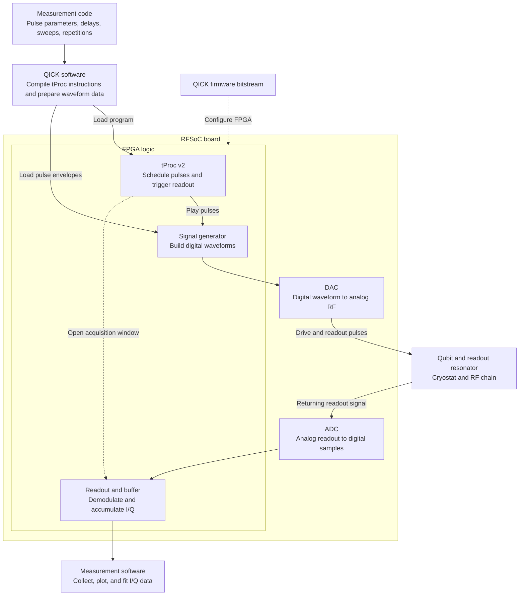

# 04 | Qubit Measurements with FPGA and QICK

Our lab uses an FPGA-based QICK setup to control and measure superconducting qubits. QICK stands for Quantum Instrumentation Control Kit. It provides open-source firmware and software for RFSoC boards. An FPGA is a programmable hardware device. In this setup, it runs pulse sequences and synchronizes readout acquisition with the pulses. The board's DACs convert digital waveforms into analog signals, and its ADCs digitize the returning readout signal. [Official QICK repository](https://github.com/openquantumhardware/qick)

## How a QICK Measurement Runs

1. **Load the firmware.** The bitstream configures the FPGA logic, including the tProc, signal generators, and readout blocks. [QICK firmware overview](https://docs.qick.dev/latest/firmware/index.html)
2. **Compile and load the measurement program.** QICK translates the sequence into tProc instructions and prepares pulse data for the board. The tProc runs the timed sequence and tells the signal generators when to play pulses and the readout buffers when to capture. [Basic sequencing with tProc v2](https://docs.qick.dev/latest/tutorials/01_Basic_Sequencing.html)
3. **Send pulses and collect data.** The DAC sends the analog drive and readout pulses. The ADC samples the returning signal. The FPGA readout logic demodulates it to I/Q and can integrate it over the acquisition window before returning it to the measurement software. [QICK readout system](https://docs.qick.dev/latest/firmware/readouts/index.html)

## Where to Learn

1. Start with the official Quick Start to learn how to set up the board and run a first pulse experiment. [QICK documentation](https://docs.qick.dev/latest/)
2. For single-qubit measurements, open **demo 06** in the official `qick_demos` folder. Follow how the notebook defines pulse parameters, sweeps a variable, and acquires readout data. [06_qubit_demos.ipynb](https://github.com/openquantumhardware/qick/blob/main/qick_demos/06_qubit_demos.ipynb)
3. For the scripts used in our lab, see our internal measurement repository. [tprocv2_guidemo](https://github.com/JayChien04717/tprocv2_guidemo)
